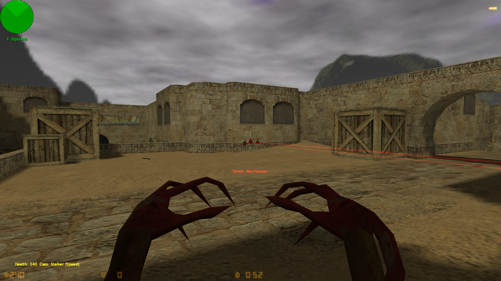
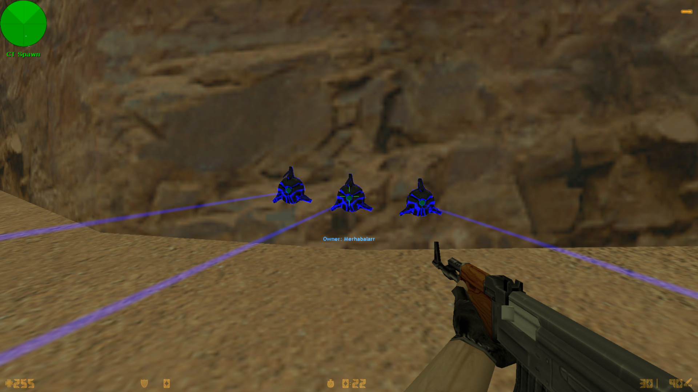
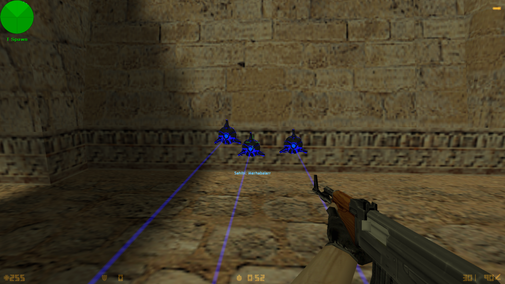
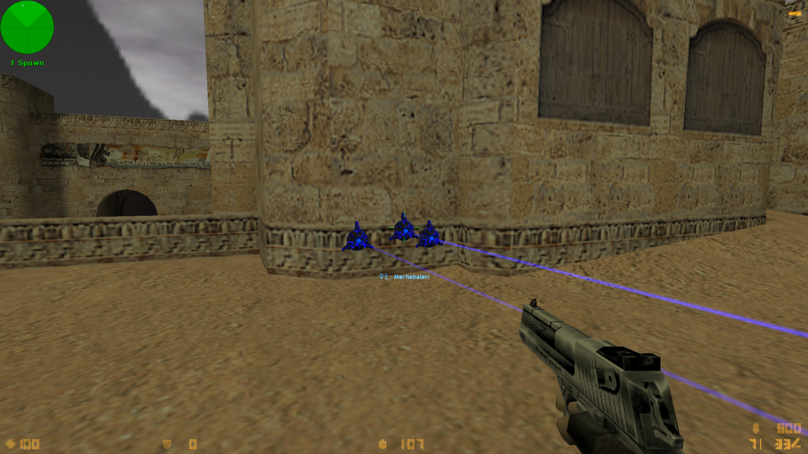

# LaserMine v1.4

**Counter-Strike 1.6 · Biohazard / Zombie Plague · AMX Mod X**

LaserMine is a laser tripmine plugin for Counter-Strike 1.6 servers running Biohazard or Zombie Plague. It provides configurable laser damage, explosion modes, mine limits and administrative controls.

<p align="center">
  <a href="#turkce">🇹🇷 Türkçe</a> ·
  <a href="#korean">🇰🇷 한국어</a> ·
  <a href="#english">🇬🇧 English</a> ·
  <a href="#cvar-reference">⚙️ CVAR Reference</a>
</p>

---

<a id="turkce"></a>

## 🇹🇷 Türkçe

### Genel Bakış

LaserMine v1.4, Counter-Strike 1.6 Biohazard ve Zombie Plague sunucuları için geliştirilmiş bir AMX Mod X lazer mayını eklentisidir.

Oyuncular lazer mayınları kurarak geçiş noktalarını savunabilir. Sunucu ayarlarına bağlı olarak sistem lazer ışını hasarı veya patlama mekaniği kullanabilir. Eklenti ayrıca yönetici kontrolleri ve yapılandırılabilir oyun ayarları sunar.

### Özellikler

- Lazer mayını kurma ve kaldırma
- Lazer ışını hasarı ve patlama modu
- Yöneticiler için mayın silme ve Laser-Ban desteği
- Ayarlanabilir mühimmat, hasar ve takım kısıtlamaları
- Işın görünürlüğü, parlaklığı ve mayın renkleri
- Korece, Türkçe ve İngilizce dil desteği

### Kontroller

| Tuş | İşlev |
|---|---|
| `V` | Lazer mayını kurma |
| `B` | Lazer mayınını kaldırma |

Eklenti, oyuncu sunucuya katıldığında bu tuşları otomatik olarak atar. İsterseniz oyun konsolundan manuel olarak da ayarlayabilirsiniz.

```cfg
bind v +setlaser
bind b +dellaser
```

### Ekran Görüntüleri

<p align="center">
  
  
  
  
</p>

### Kurulum

1. Depodaki `addons/` klasörünü sunucunuzun `cstrike/addons/` dizinine kopyalayın.
2. `zpbio_laser.sma` dosyasını açın ve `ZOMBIE_PLAGUE` veya `BIOHAZARD` tanımlarından yalnızca birini etkinleştirin.
3. Kaynak kodunu sunucunuzdaki AMX Mod X sürümüyle uyumlu derleyiciyle derleyin.
4. Oluşturulan `zpbio_laser.amxx` dosyasını `addons/amxmodx/plugins/` dizinine yerleştirin.
5. `addons/amxmodx/configs/plugins.ini` dosyasına şu satırı ekleyin:

```ini
zpbio_laser.amxx
```

6. Gerekli dil dosyalarının `addons/amxmodx/data/lang/` dizininde bulunduğunu kontrol edin.
7. Sunucuyu yeniden başlatın veya eklentiyi yeniden yükleyin. Ardından kurma ve kaldırma işlemlerini test edin.

**Dil dosyaları:** Eklenti `LaserMines.txt` ve `LaserMines_Extra.txt` dosyalarını yükler. Depoda yalnızca `LaserMines_Extra.txt` bulunuyorsa temel `LaserMines.txt` dosyasını ilgili eklenti paketinden ayrıca temin etmeniz gerekir.

### v1.4 Yenilikleri

**Kurulum hatası düzeltmeleri**

- Başarısız kurulum denemelerinde oluşabilen sahipsiz entity sorunu giderildi.
- Başarısız kurma veya toplama işlemlerinden sonra oyuncunun hareket hızının ya da ilerleme çubuğunun takılı kalmasına neden olan durumlar düzeltildi.
- Mayın oluşturulmadan önce kurulum konumu doğrulanıyor.

**Nişan ve durum kontrolü**

- Kurulum ışını artık oyuncunun göz hizasından başlıyor.
- Oyuncuların veya mevcut lazer mayınlarının üzerine yeni mayın kurulması engelleniyor.
- 1,2 saniyelik kurulum süreci tamamlandığında mühimmat, hayatta olma durumu ve mayın sınırı yeniden kontrol ediliyor.

**Performans ve kararlılık**

- CVAR erişimi `bind_pcvar_*` kullanımıyla iyileştirildi.
- Sık çalışan `Think`, `Touch` ve `TraceLine` hook'larında tekrarlanan sınıf adı karşılaştırmaları yerine O(1) `pev_impulse` etiketi kontrol ediliyor.
- Negatif mayın sayacı ve yinelenen görevler için korumalar eklendi.
- Bağlantısı kesilmiş oyuncuların işlenmesi iyileştirildi.
- `BarTime` mesaj kimliği sabit bir değer yerine çalışma zamanında alınıyor.
- Tekrarlanan izleme kodu `GetPlantSpot()` yardımcı fonksiyonunda birleştirildi.

**Derleme gereksinimi:** Yeni düzeltmelerin çalışması için `zpbio_laser.sma` dosyasını kullandığınız AMX Mod X sürümüyle uyumlu şekilde yeniden derleyin.

---

<details>
<summary>🇰🇷 한국어 — Korean (Click to expand)</summary>

<a id="korean"></a>

## 한국어

### 소개

LaserMine v1.4는 Counter-Strike 1.6의 Biohazard 및 Zombie Plague 서버를 위한 AMX Mod X 레이저 지뢰 플러그인입니다.

레이저 지뢰를 설치해 주요 통로를 방어할 수 있으며, 서버 설정에 따라 레이저 빔 피해 또는 폭발 방식으로 작동합니다. 관리자 기능과 다양한 CVAR 설정도 지원합니다.

### 주요 기능

- 레이저 지뢰 설치 및 제거
- 레이저 빔 피해 및 폭발 모드
- 관리자용 지뢰 제거 및 Laser-Ban 기능
- 탄약, 지뢰 개수 및 팀 제한 설정
- 빔 밝기와 색상 설정
- 한국어, 영어 및 터키어 지원

### 조작 방법

| 키 | 기능 |
|---|---|
| `V` | 레이저 지뢰 설치 |
| `B` | 레이저 지뢰 제거 |

플러그인은 플레이어가 서버에 접속할 때 해당 키를 자동으로 설정합니다. 필요한 경우 게임 콘솔에서 직접 설정할 수도 있습니다.

```cfg
bind v +setlaser
bind b +dellaser
```

### 스크린샷

<p align="center">
  
  
  
  
</p>

### 설치 방법

1. 저장소의 `addons/` 폴더를 서버의 `cstrike/addons/` 디렉터리에 복사합니다.
2. `zpbio_laser.sma`에서 `ZOMBIE_PLAGUE` 또는 `BIOHAZARD` 중 하나만 활성화합니다.
3. 사용 중인 AMX Mod X 버전에 맞는 컴파일러로 소스 코드를 컴파일합니다.
4. 생성된 `zpbio_laser.amxx` 파일을 `addons/amxmodx/plugins/`에 넣습니다.
5. `addons/amxmodx/configs/plugins.ini`에 다음 항목을 추가합니다.

```ini
zpbio_laser.amxx
```

6. 필요한 언어 파일이 `addons/amxmodx/data/lang/`에 있는지 확인합니다.
7. 서버를 재시작하거나 플러그인을 다시 로드한 뒤 정상 작동을 확인합니다.

**언어 파일 안내:** 플러그인은 `LaserMines.txt`와 `LaserMines_Extra.txt` 파일을 사용합니다. 저장소에 `LaserMines_Extra.txt`만 포함되어 있다면 기본 `LaserMines.txt` 파일은 기존 플러그인 패키지에서 별도로 준비해야 합니다.

### v1.4 변경 사항

**설치 오류 수정**

- 설치에 실패했을 때 발생할 수 있는 불필요한 엔티티 생성을 방지했습니다.
- 설치 또는 회수 실패 후 플레이어의 이동 속도와 진행 바가 정상적으로 초기화되지 않던 문제를 수정했습니다.
- 지뢰 엔티티를 생성하기 전에 설치 위치를 검증하도록 변경했습니다.

**조준 및 상태 검증**

- 설치 트레이스가 플레이어의 눈 위치에서 시작됩니다.
- 플레이어나 기존 레이저 지뢰 위에는 설치할 수 없습니다.
- 1.2초 설치 과정이 끝날 때 탄약, 생존 상태 및 지뢰 제한을 다시 확인합니다.

**성능 및 안정성**

- `bind_pcvar_*`를 사용해 CVAR 접근을 개선했습니다.
- `Think`, `Touch`, `TraceLine` 훅에서 반복적인 클래스 이름 비교 대신 `pev_impulse` 태그 검사를 사용합니다.
- 지뢰 카운터가 음수가 되는 상황과 중복 작업을 방지하는 보호 로직을 추가했습니다.
- 접속이 종료된 플레이어를 처리하는 로직을 보완했습니다.
- `BarTime` 메시지 ID를 고정값 대신 실행 시점에 조회합니다.
- 중복된 트레이스 코드를 `GetPlantSpot()` 함수로 통합했습니다.

**컴파일 안내:** v1.4의 변경 사항을 적용하려면 `zpbio_laser.sma`를 사용 중인 AMX Mod X 버전에 맞게 다시 컴파일해야 합니다.

</details>

---

<details>
<summary>🇬🇧 English (Click to expand)</summary>

<a id="english"></a>

## English

### Overview

LaserMine v1.4 is an AMX Mod X laser tripmine plugin for Counter-Strike 1.6 servers running Biohazard or Zombie Plague.

Players can deploy laser mines to defend key areas. Depending on the server configuration, mines can deal beam damage or use an explosion-based damage system. The plugin also provides administrative controls and configurable gameplay settings.

### Features

- Laser mine deployment and removal
- Beam damage and explosion modes
- Administrative mine removal and Laser-Ban support
- Configurable ammunition, damage and team restrictions
- Adjustable beam visibility, brightness and mine colors
- Korean, English and Turkish language support

### Controls

| Key | Action |
|---|---|
| `V` | Plant a laser mine |
| `B` | Remove a laser mine |

The plugin automatically binds these keys when a player joins the server. They can also be configured manually through the game console.

```cfg
bind v +setlaser
bind b +dellaser
```

### Screenshots

<p align="center">
  
  
  
  
</p>

### Installation

1. Copy the repository's `addons/` directory into your server's `cstrike/addons/` directory.
2. Open `zpbio_laser.sma` and enable exactly one of `ZOMBIE_PLAGUE` or `BIOHAZARD`.
3. Compile the source using a compiler compatible with your installed AMX Mod X version.
4. Place the generated `zpbio_laser.amxx` file in `addons/amxmodx/plugins/`.
5. Add the following entry to `addons/amxmodx/configs/plugins.ini`:

```ini
zpbio_laser.amxx
```

6. Ensure the required language files are available in `addons/amxmodx/data/lang/`.
7. Restart the server or reload the plugin, then verify that planting and removal work correctly.

**Language files:** The plugin loads `LaserMines.txt` and `LaserMines_Extra.txt`. If only `LaserMines_Extra.txt` is included in this repository, obtain the base `LaserMines.txt` file from the corresponding plugin package.

### What's New in v1.4

**Planting bug fix**

- Prevented orphaned entities when a planting attempt fails.
- Fixed cases where player movement speed or the progress bar could remain stuck after a failed planting or pickup operation.
- The planting location is now validated before the mine entity is created.

**Improved targeting and validation**

- Planting traces now originate from the player's eye position for more accurate targeting.
- Planting on players or existing laser mines is rejected.
- Ammo, alive state and mine limits are checked again when the 1.2-second planting progress completes.

**Performance and stability**

- Improved CVAR access using `bind_pcvar_*`.
- Replaced repeated classname comparisons in the frequently called `Think`, `Touch` and `TraceLine` hooks with an O(1) `pev_impulse` tag check.
- Added safeguards against negative deployment counters and duplicate tasks.
- Improved handling of disconnected owners.
- The `BarTime` message ID is resolved at runtime instead of using a hard-coded value.
- Consolidated duplicated trace logic into `GetPlantSpot()`.

**Build requirement:** Compile `zpbio_laser.sma` with a compiler compatible with your AMX Mod X installation to generate the updated `.amxx` file.

</details>

---

<a id="cvar-reference"></a>

## ⚙️ CVAR Reference

The following table lists the configuration values and default values provided for this release. Check the source code to confirm the accepted values and exact behavior of each setting.

| CVAR | Default | Description |
|---|---:|---|
| `zp_ltm` | `1` | Enable or disable the plugin |
| `zp_ltm_acs` | `0` | Restrict access to admins with immunity when set to `1` |
| `zp_ltm_mode` | `0` | `0` = beam damage; otherwise, explosion mode |
| `zp_ltm_ammo` | `3` | Maximum mines carried or deployed per player |
| `zp_ltm_startammo` | `3` | Mines granted at round start |
| `zp_ltm_teammax` | `200` | Maximum deployed mines per team |
| `zp_ltm_dmg` | `100` | Beam damage |
| `zp_ltm_rdmg` | `100` | Explosion damage |
| `zp_ltm_radius` | `320.0` | Explosion radius |
| `zp_ltm_ldmgmode` | `2` | Beam damage mode |
| `zp_ltm_ldmgseconds` | `1` | Beam damage interval |
| `zp_ltm_ff` | `0` | Friendly-fire setting |
| `zp_ltm_cbt` | `ALL` | Who can plant: `H`, `Z` or `ALL` |
| `zp_ltm_buymode` | `0` | Enable or disable mine purchases |
| `zp_ltm_cost` | `0` | Purchase price |
| `zp_ltm_fragmoney` | `1` | Ammo or money reward for kills |
| `zp_ltm_health_mode` | `0` | Whether mines can be shot |
| `zp_ltm_health` | `5` | Mine health |
| `zp_ltm_brokeenemy` | `0` | Only enemies can destroy mines |
| `zp_ltm_cmdmode` | `1` | `1` = bind commands only; `0` = also allow the use key |
| `zp_ltm_noround` | `1` | Prevent planting before the round starts |
| `zp_ltm_delay` | `0.1` | Delay after spawning before planting |
| `zp_ltm_line` | `3` | Beam visibility setting |
| `zp_ltm_bright` | `100` | Beam brightness |
| `zp_ltm_glow` | `1` | Enable or disable mine glow |
| `zp_ltm_color` | `0` | Mine color mode; `0` uses random colors |

---

## Feedback

Bug reports, compatibility issues and improvement suggestions are welcome. When reporting an issue, include your AMX Mod X version, the game mode you are running and any relevant server logs.

<p align="center">
  <sub>LaserMine v1.4 · Counter-Strike 1.6</sub>
</p>
